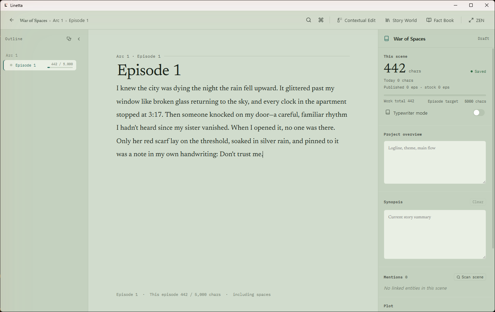
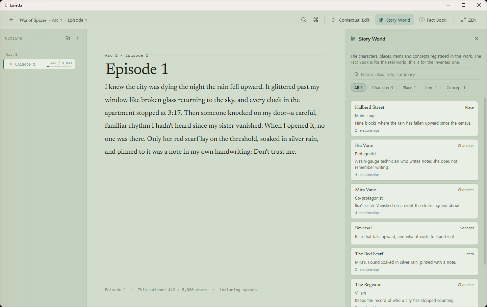
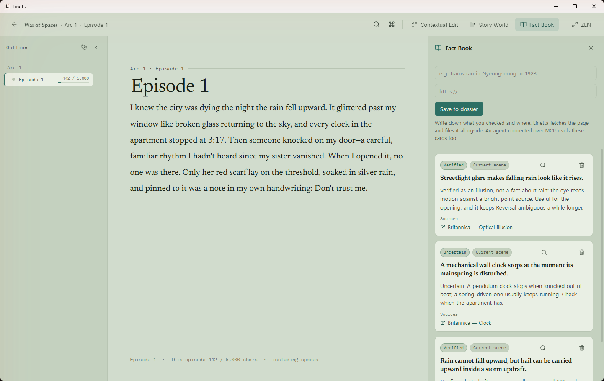
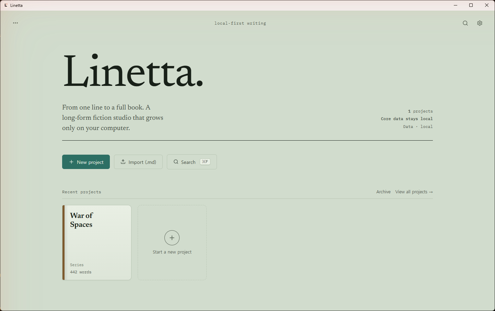

<div align="center">
  

# Linetta

### A calm, local-first writing studio for long-form fiction

Plan your story, keep your world consistent, and write scene by scene. When you want to write alongside AI, use Linetta's built-in agent or connect one you already run over MCP — neither happens on its own.

[](https://github.com/devlikebear/linetta/releases/latest)
[](https://github.com/devlikebear/linetta/actions/workflows/ci.yml)
[](LICENSE)

[Website](https://linetta.marvin-42.com) · [Mac App Store](https://apps.apple.com/app/id6781664781) · [Download for Windows or Linux](https://github.com/devlikebear/linetta/releases/latest) · [Report an issue](https://github.com/devlikebear/linetta/issues)

English · 한국어 · 日本語
</div>



## One workspace for the whole story

Linetta is made for novelists and web-fiction writers who want their manuscript, outline, characters, places, relationships, and research close at hand — without turning writing into project management.

- **Write with focus.** Work scene by scene in a quiet editor with your outline always within reach.
- **Keep the story consistent.** Organize characters, places, relationships, storylines, beats, summaries, and memories beside the manuscript.
- **Stay in control of AI.** Linetta calls a model only if you connect a provider — for the built-in agent, or your own agent over MCP. The activity log shows what changed and whether the built-in agent or an external client made the call, a recent structural change can be undone in one click while the app stays open, and the text an agent replaces is kept as a restorable version of the scene.
- **Keep your work local.** Projects live in a local SQLite database with version snapshots and daily backups. No Linetta account or mandatory cloud is required.
- **Publish when you choose.** Optionally connect an account on [Linetta Works](https://works.marvin-42.com) and put an episode up for readers straight from the app. Only the episodes you publish leave your device.
- **Move your manuscript freely.** Import and export Markdown, and optionally sync exported work through Git.

## See Linetta in action

| The work's own record | Research without leaving the scene |
| --- | --- |
| Story World lists the characters, places, items and concepts your work has registered — including the ones an agent created, whether the built-in agent or one connected over MCP. | Fact Book keeps source-backed notes next to the writing that needs them. |
|  |  |

Your projects stay organized in a library built for multiple works:



## Get Linetta

### Website

Product overview and downloads: [linetta.marvin-42.com](https://linetta.marvin-42.com).

### Mac App Store

Linetta is free on the [Mac App Store](https://apps.apple.com/app/id6781664781).

### Homebrew on Apple Silicon

The direct macOS build is signed with an Apple Developer ID and notarized by Apple.

```sh
brew install --cask devlikebear/tap/linetta
```

Linetta updates itself from then on: choose **Check for Updates…** in the
Linetta menu or the tray menu. It also checks once after launch and asks before
downloading anything. `brew upgrade --cask linetta` keeps working too.

### Windows and Linux

Every [GitHub release](https://github.com/devlikebear/linetta/releases/latest) includes Windows NSIS and MSI installers plus Linux AppImage, `.deb`, and `.rpm` packages.

These builds update themselves the same way, from **Check for Updates…** in the
tray menu. The Mac App Store build is updated by the App Store instead.

Intel Mac users can [build from source](#build-from-source).

## Writing with the built-in agent (BYOK)

Linetta has a built-in writing agent, but it has nothing to call until you
bring your own connection to a model. Five providers are supported: ChatGPT
(Codex) by signing in with your ChatGPT account; Claude Code, which runs the
`claude` CLI you already have installed under your own Claude sign-in, with no
API key (Homebrew and direct-download builds only, not the Mac App Store
build); and Anthropic, Google Gemini, or an OpenAI-compatible endpoint —
OpenRouter, or a model running on your own machine — by API key.

Turn it on in **Settings → AI provider**. Consent is per provider, and it
gates even the connection test: that button is refused until you have given
that provider a credential and ticked its consent box. The one request that
runs on a credential alone is asking the provider which models it offers, so
the picker has something to list; that request carries no manuscript text.

An API key goes into your OS's secure credential store, never into
`settings.json`; signing in with Codex instead stores its tokens in Linetta's
own data directory, in a file only your account can read.

Linux has no secure credential store backend, so Anthropic, Google Gemini,
and the OpenAI-compatible endpoint cannot be configured there; signing in
with a ChatGPT account still works, since that path stores tokens in
Linetta's data directory instead.

Open the agent with the toolbar **Agent** button or `Cmd/Ctrl+J`; connect a
provider first, or the panel prompts you to set one up. Two chips under the
input box show the provider and model the next turn will use, and you can
switch either one there between turns. It reaches Linetta's tools the same way an
external MCP client does, and every call it makes is recorded in the MCP
activity log, which shows whether the built-in agent or an external client
made it. A structural change — outline restructuring and the like — gets an
Undo button on its own line in the agent panel, good for one click while the
app stays open; only the last eight are held, in memory, and none survive a
restart. A scene the agent wrote can be reverted the same way from its tool
line (the panel offers undo whenever a line carries a `batch_id` or a
`snapshot_id`). Linetta also snapshots the scene before every agent write and
keeps that version indefinitely, so you can put the old text back from the
scene's **Previous versions** sheet.

### Your direction

A work has a **current focus** — what to concentrate on for the next few
episodes — and any scene can have its own **intent**: a one-line goal, what
to keep, what to avoid. Both are yours to write; no agent tool can set
either. They sit at the very top of the story brief, ahead of everything
else, under a "Writer's Direction" heading the built-in agent treats as
binding — and the same brief is what a connected MCP client reads too, read-only
mode included. Set the focus and it is three episodes' worth of actually-
written scenes later, the app and the brief both flag it as possibly stale
and ask you to confirm it still holds.

If you have picked a branch in **Where the story could go** (below), it
appears right after the scene intent, labelled a plan — never canon — with
its title, premise, and beats. If the outline, manuscript, Story World, or
your own direction changed since the branch was drawn, the brief says so
and asks the agent to check with you before following it. Turning the
Writer's Direction switch off in the AI context checklist removes the plan
along with the rest of the section.

### What the agent remembers

Linetta keeps two short documents an agent reads: a **writer profile** — how
you work, up to 1,400 characters — and **work notes** for each work, up to
2,200. Both are pasted whole into the built-in agent's system prompt at the
start of every turn, with a line saying how much of the budget is used, and
the agent records into them with its `linetta_edit_memory` tool. You can read
and rewrite both yourself in **Settings → Memory**, one work at a time.

**The writer profile is not scoped to the work you have open.** It is global,
and it is read for every work. Something an agent records about you while
working on one book is in the system prompt of every other book, and in the
story brief a connected MCP client receives on any work. Work notes stay with
their work.

Both live in `library.db`, so the daily backup carries them, and so does
restoring: **Settings → Backup**, which brings a single work back from a
backup as a new project, brings that work's notes back with it. The writer
profile is global and stays with the library — a per-work restore never
copies or duplicates it. The startup recovery screen, which appears only when
the app cannot open the library and replaces the whole database file, brings
both documents back.

### What the agent learns

Beside the memories, an agent keeps **skills**: short how-to documents about
method, not about the story — how you want a fight scene paced, how a
recurring character speaks. Facts about the world belong in the Fact Book and
in memory; skills hold procedures.

Each one is a plain `SKILL.md` file with agentskills.io YAML frontmatter, in
its own folder under your data directory:

```text
<app data>/skills/<name>/SKILL.md                     every work
<app data>/skills/works/<project id>/<name>/SKILL.md  one work
```

That is deliberate. You can open a skill in any editor, keep the folder in
git, or point your own Claude Code at it and have it find the shape it
expects. At most 40 skills per scope, a description of 200 characters and a
body of 8,000.

Only the **names and descriptions** of enabled skills go into the built-in
agent's system prompt and into the story brief an MCP client reads; the body is
fetched on demand with `linetta_read_skill`. The story brief lists every one.
The system prompt holds that list to about 3,000 characters and, when they do
not all fit, says how many it is showing.

**A skill under `skills/<name>/` is global**, the same way the writer profile
is. It is offered on every work, not only the one you have open. A skill under
`skills/works/<project id>/` stays with its work.

**An agent writes a skill without asking you first.** There is no approval
gate: `linetta_edit_skill` creates, patches and deletes, and the change is
saved. What you get instead is on the record and in your hands — every skill
carries a badge saying whether you or an agent wrote it, every write is kept
as a version you can read and revert to, and one switch turns a skill off so
it leaves the prompt without being deleted. All of it is in **Settings →
Skills**, where you can also write and edit skills yourself.

**The self-review is an extra model call.** After a turn in which the built-in
agent executed eight or more tool calls — and after your reply has already been
sent — Linetta asks the same provider and the same model, in a separate
request, whether that turn taught it a technique worth recording or showed a
skill to be wrong. Most turns answer "nothing" in one round trip; a turn that
does write a skill costs up to five. It is on by default and it is
metered by your provider like any other call. Turn it off under **Settings →
Skills → Learning from its own work** (`agent_self_review_enabled` in
`settings.json`) and Linetta does not make that call at all. The Claude Code
provider never runs it, since that second turn would spend your plan's usage
without you asking for it.

**You can switch the memory, skills, review, and visual editing tools off
entirely.** Every tool's full description travels in every request, so
Linetta's thirty tools are a standing cost on every turn — and the memory
tool, the two skills tools, and the continuity-check tool together are a
meaningful share of it. **Settings → Tool budget** says how many tools the
agent currently gets and what each group costs, and turns each group off for
both the built-in agent and any MCP client (`memory_tools_enabled`,
`skill_tools_enabled`, and `review_tools_enabled` in `settings.json`; all on
by default, and `visual_write_tools_disabled`, false by default). Switching a
group off also removes the instructions that name its tools — a prompt telling
an agent to use a tool it has not been given is worse than the tool's cost.
Each switch takes effect on your very next message; there is nothing to
restart. With the skills tools off the self-improvement pass cannot run at
all, and the Skills pane says so.

The memory, skills, and review groups lose different things. With the memory
tool off, what is already recorded is still read back to the agent — it just
cannot add to it, and you can still edit it yourself under Settings → Memory.
With the skills tools off, the skill **list** goes too: a list with no
`linetta_read_skill` to open a body is only names. With the review tools off,
`linetta_report_continuity` and the agent panel's continuity starter chip
both go — observations already recorded stay exactly where they are in Story
World. Nothing is deleted either way, and switching a group back on restores
it exactly.

**A turn stops after a set number of tool calls.** The built-in agent makes at
most 48 tool calls in one turn by default. Change it under **Settings → Tool
budget → Tool calls per turn** (`agent_max_tool_calls` in `settings.json`,
8–200); a higher limit lets a long request finish in one turn, and also lets a
turn cost more. When a turn reaches the limit, or the same tool fails three
times in a row, Linetta makes one more request with tools switched off, so the
agent says what it finished and what is left. Send "continue" to pick up from
there. A changed limit applies from the next turn, not to one already running.
External MCP clients are not affected.

**The daily backup does not carry the skills folder.** It is `VACUUM INTO` on
`library.db` and copies nothing else under your data directory. What it does
carry is the version history: every write and every delete lands a row holding
that skill's whole text in `library.db`, so the history survives even though
the files do not. A skill whose file is gone still appears in Settings →
Skills under "Skills that survive only in history," with the same history
panel and restore button every other skill uses. One consequence worth
knowing: a skill you have never edited through Linetta — one you hand-wrote
into the folder and never saved from Settings — has no row anywhere. If the
skills folder matters to you, copy it yourself, or keep it in git.

Character visual sheets hold appearance notes and up to eight reference images
per character. Set the illustration style in Story World; sheets, images and
style guides are included in library backups and restored works.
`linetta_get_character_visuals` reads these designs and optional reference images;
`linetta_build_illustration_prompt` builds a single illustration or four-panel
prompt from them and your scene description.

A work's **style rules** are the part of your style a machine can check:
phrases to keep out and a sentence-length limit, kept under Story World →
Style rules and check. The check lists each place a scene breaks a rule — the
scene, the paragraph, the phrase — and changes nothing; what to do about it is
yours to decide. `linetta_analyze_style` runs the same check for an agent, so
one that drafted a scene can hold it against your rules before handing it
back. It does not judge tone: that stays with the style notes in the brief and
whoever reads them. Rules are in library backups and restored works.

You do not have to describe your style from memory. Ask an agent to work it
out from scenes you have already written: `linetta_analyze_style` also
measures them — sentence lengths, how much is dialogue, how your sentences
tend to end — and `linetta_propose_style_profile` saves what the agent makes
of that as a **draft**. A draft is the agent's reading, not your instruction,
so it stays out of your style notes and out of every brief until you approve
it under Story World → Style, where you can edit it first, add it after your
notes, replace them with it, or discard it. No tool approves a draft; only
you do.

Visual write tools (full mode): `linetta_set_character_visuals` (`project_id`, `name` or
`entity_id`, optional `age_range`, `build`, `hair`, `outfit`, `signature`, `palette`, `notes`),
`linetta_set_art_style` (`project_id`, optional `style`, `negative_prompt`),
`linetta_add_reference_image` (`project_id`, `name` or `entity_id`, `data_base64`, `mime`, optional `caption`),
and `linetta_delete_reference_image` (`image_id`). Omitted patch fields are unchanged;
empty strings clear them. Images use PNG/JPEG/WebP/GIF, at most 5 MiB and 8 per character.
Each returns `undo_batch_id` for the agent undo button or `linetta_undo_last_change`
(`batch_id`); deleting an image retains its bytes and metadata in the bounded,
in-memory undo window (8 changes; cleared on restart). Set
`visual_write_tools_disabled` in settings to omit this optional group.

### Continuity checks

Ask the agent to check a scene's continuity — the "연속성 점검" starter chip
does this in one click — and it reads the scene with paragraph numbers, holds
it against Story World, your fact cards, earlier scenes, and your own
direction, and records what it finds with `linetta_report_continuity`. The
engine checks every quote and every reference before anything is stored: a
quote has to be an exact substring of the numbered paragraphs it cites, and
a reference has to name an entity, fact card, beat, or scene this work
actually has. A call that fails either check is refused with a sentence the
agent can act on, not silently accepted. An empty result — nothing wrong —
is recorded too, so "I checked and it's fine" is on the record the same way
a finding is.

**Nothing in the manuscript changes.** What you get is a list, under Story
World → Continuity checks: each finding's severity, category, summary, the
exact quote and paragraph it is about, a reference chip you can click to
open the entity, fact, or earlier scene it points at, and an optional
suggestion. You open the scene, mark it dismissed or resolved, or leave it.
If the scene's text has changed since the check, the group is flagged "본문이
바뀜 · 다시 점검" so you know the finding may be stale. A badge in the
right-hand scene panel shows how many open observations the current scene
carries, with a click to Story World's continuity section.

Continuity checks are a judgement call the agent makes when asked, not a
background pass. They are a different thing from the automatic consistency
re-check after a name or setting change (contextual edit): that one is
deterministic (it catches a name it just renamed and missed) and shows a
report immediately; continuity checks are the agent's own reading, held
until you act on it, and they do not replace each other.

Observations live in `library.db`, so they are in daily backups and travel
with a work restored from one — including the writer's own dismissed and
resolved judgements, which are work too valuable to lose on a restore.
References inside an observation are remapped to the restored work's own
ids; one that no longer resolves is dropped rather than left dangling. Turn
the group off under **Settings → Tool budget → Check & propose**
(`review_tools_enabled` in `settings.json`, on by default) to remove
`linetta_report_continuity` and the starter chip for both the built-in agent
and any MCP client; observations already recorded stay exactly where they
are.

### Suggestions inbox

Ask the agent to create one character, place, or relationship directly and
it applies right away with `linetta_apply_story_ops` — the small-change
path, same as before. Anything pulled from the manuscript, or more than a
few world elements at once, goes through a different tool,
`linetta_propose_story_ops`: nothing is applied. Each candidate — a
character, place, item, concept, relationship, fact card, storyline, or
beat — lands in the **suggestions inbox** instead, grouped by kind, for you
to accept, edit, or reject one at a time. A badge on Story World's header
("제안함 N") shows how many are waiting; opening it, or running "제안함 열기"
from the command palette, shows the inbox as a sheet beside the editor.

Each candidate shows why the agent proposed it: the quote it cited from the
manuscript, with a link to open that scene, and any citations it offered
when asked for more than one. A new character or place whose name or alias
normalizes to the same text as one you already have — ignoring spacing,
case, and the middle dot — is flagged "같은 대상일 수 있음"; you can turn it
into an alias of the existing record with one click instead of creating a
duplicate. The engine only flags the match — it never merges on its own. A
relationship that depends on a character candidate you have not accepted
yet is marked "생성이 먼저 필요"; selecting it selects that character too, so
accepting never leaves a dangling reference. Rejecting an item never
cascades to whatever depended on it — that item just stays in the inbox,
marked as blocked, until you decide.

Right after importing a Markdown manuscript, if a provider is connected,
Linetta offers to fill Story World from it: a dialog shows the episode
count, character count, and a rough input-token estimate (an estimate, not
a billed cost) before anything runs. Starting it opens the agent panel with
the extraction request already typed — you still press send, the same as a
starter chip. The agent works through the manuscript episode by episode,
checks what already exists first, and proposes with citations as it goes;
if it runs into its tool-call budget partway through, tell it to continue
and it picks up from the first episode it has not covered yet, using the
engine's own progress count rather than guessing.

Suggestions live in `library.db` alongside everything else, but they are
deliberately **not** carried over when you restore a single work from a
backup: a pending item's reference still names ids from the library it came
from, and a suggestion costs nothing to make again by asking the agent.
Turn the group off under **Settings → Tool budget → Check & propose**
(`review_tools_enabled` in `settings.json`, on by default) to remove
`linetta_propose_story_ops` and the "Story World 채우기" starter chip for
both the built-in agent and any MCP client — items already in the inbox
stay exactly where they are.

### Where the story could go

Ask the agent "다음 회차 전개 갈래 3개를 만들어 줘" — or press the starter chip — and
it drafts 2–5 possible continuations from your last written episode and
saves them with `linetta_save_forecast`. **Nothing is canon.** The outline,
the manuscript, and Story World do not change; what you get is a sheet,
opened from the command palette ("갈래 예측 열기") or a button on the outline
panel's header, where every branch sits side by side: a title and premise,
an episode-by-episode beat timeline, risk badges you can click through to
the character, fact, or scene they are about, and — folded by default —
the character decisions, projected changes, open questions, and how the
branch fits your own direction.

**Picking a branch is a direct click, not a chat turn.** [이 갈래 고르기] and
[선택 해제] call the engine straight away; no agent runs, and your activity
log gains no new entry. The branch you pick appears in the next brief's
Writer's Direction section as a **plan** — see "Your direction" above — so
every later turn, built-in agent or MCP client, sees it without being told
again. If you want it in the outline, press [개요 반영 제안 요청]: it fills the
agent panel with a ready-to-send request, the agent proposes scenes and
beats to the suggestions inbox (never writes directly), and you apply them
there like any other suggestion. Accepting a forecast's structural
proposal gets its own one-click undo in the inbox, reverting the outline
change and anything hung on it together.

A forecast goes stale the moment canon it was drawn from changes —
anything in the outline, the manuscript (any episode's text, not only the
one you diverged from), Story World, or your own direction — and the sheet
says what moved, e.g. "정사가 바뀜: 인물 2개, 3화 본문". The check runs fresh
every time you open the sheet, so undoing the change that made a forecast
stale makes it fresh again; nothing here is a one-way flag. A stale
forecast can still be picked — the warning follows the choice into the
toast, not a refusal.

Forecasts live in `library.db` but are **not** carried over when you
restore a single work from a backup, for the same reason the suggestions
inbox is not: a branch's own references, and the episode it diverged from,
still name ids from the library it came from, and a forecast costs nothing
to draft again by asking the agent. Turn the group off under
**Settings → Tool budget → Check & propose** (`review_tools_enabled` in
`settings.json`, shared with continuity checks and the suggestions inbox,
on by default) to remove `linetta_save_forecast` and its starter chip for
both the built-in agent and any MCP client — forecasts already saved stay
exactly where they are, and you can still open the sheet and pick among
them.

## Writing with your own agent (MCP)

Connecting an outside agent over MCP is a different thing from connecting a
provider in Settings: a writer who only wants MCP never has to give Linetta a
credential at all.

When you want to write alongside AI, Linetta opens a local MCP endpoint and an
agent you already run — Claude Code, Claude Desktop, Codex CLI, or Gemini CLI —
connects to it. The subscription you already pay for does the work; Linetta
stays a writing tool.

Turn it on in **Settings → Connect an external agent (MCP)**. It is off until
you tick an explicit consent box. When those clients are detected, Settings
offers one-click connect; the pane still gives you a copyable command to paste
into your client.

Once connected, an agent can:

- read the outline, a scene, characters, fact cards, and a story brief;
- draft and revise scenes, write summaries, and restructure the outline;
- publish an episode to Linetta Works, once you have connected an account and published the work yourself (`full` mode only);
- record what it changed, so you can see it in the activity log.

The story brief also carries the writer profile and the work's notes described
above, in `read_only` and `full` alike. In `full` mode a client can write them with
`linetta_edit_memory`; in `read_only` that tool is not registered at all. A
client you have pinned to a single work can write only that work's notes — the
writer profile applies to every work, so it is outside the pin, and the tool
refuses it.

Skills work the same way. The brief lists every enabled skill's name and
description, in both modes, and `linetta_read_skill` opens one — that tool is a
read tool, registered in `read_only` as well. Writing is `linetta_edit_skill`,
which like every other write tool exists only in `full` mode. A pinned client
can write a skill for its own work and is refused on a global one, for the same
reason it is refused on the writer profile.

The writer keeps the last word. Every scene write is snapshotted before it
lands, and a recent outline restructuring or scene-prose rewrite can be
reversed in one click from the agent tool line — the last eight, until the
app is restarted; entity, storyline, beat, fact-card and memory edits are
logged but have to be reversed with another edit. `read_only` mode omits the writing tools
entirely, and a scene you are part way through editing is never replaced behind
your back — Linetta tells you the agent touched it and leaves your text alone
until you choose.

The endpoint binds `127.0.0.1` only, requires a token Linetta generates
locally, and stops the moment you turn it off.

## Publishing to Linetta Works

[Linetta Works](https://works.marvin-42.com) is a reading site for fiction
written in Linetta. Publishing to it is optional: nothing is sent to the site
until you connect an account, and after that only the episodes you choose to
publish.

**Connect.** Open **Settings → Publishing**, read what publishing sends, tick
the box, and press **Connect in browser**. The site opens in your browser with
a confirmation code; check it matches the one Linetta shows and press
**Allow**. Linetta then shows your pen name. This build of the feature is for
desktop; it is hidden on iOS.

**Publish.** Open an episode's menu in the outline — or a scene's, which
publishes the episode it belongs to — and choose **Publish this episode…**, or
use the command palette. The first time, Linetta asks for the blurb readers see
and whether the work is ongoing or complete; the title and genres come from
the work itself. The dialog shows the episode's address, with a copy and an
open button. Edit the episode later and the outline marks it **Edited**;
publish again and the same address shows the new text. Episode numbers follow
your outline, and an episode you move or insert renumbers the ones after it —
their old addresses redirect. You can make an episode private from the same
dialog. An agent you connected (built-in or over MCP) can publish too, with
`linetta_publish_episode`, but only after you have connected and published the
work once yourself; it cannot connect an account or register a work.

**What is sent, and where.** The published episode's title and text, its
place in the order, and the work's title, genres, blurb, serial status and
address go to the Linetta Works server, which is run by Linetta's developer,
and are public for anyone to read. The site sends published text to the
Anthropic API for content review. Unpublished episodes, notes, character
sheets, fact cards and agent memories are never sent. See the
[privacy policy](docs/privacy-policy.md), section 3.5.

**Where the connection is kept.** The publish token is kept in the macOS
Keychain or the Windows Credential Manager. Linux has no secure store Linetta
can use, so there it is kept in `publish-token` in Linetta's data folder,
readable only by your user. Your pen name and the site address are kept in
`settings.json`.

**Disconnect.** **Settings → Publishing → Disconnect** forgets the connection
on this device. To remove the device from your device list on the site,
disconnect it from your profile there. Episodes you published stay up until
you make them private or delete them.

## Data and safety

Linetta stores writing data on your device:

```text
macOS    ~/Library/Application Support/com.devlikebear.linetta
Linux    ${XDG_DATA_HOME:-~/.local/share}/com.devlikebear.linetta
Windows  %APPDATA%\com.devlikebear.linetta
```

Important data includes:

- `library.db`: projects, scenes, story data, version snapshots, the writer profile and work notes an agent reads, the version history of every skill, and the retired built-in companion's transcripts;
- `backups/YYYY-MM-DD/`: daily backups of `library.db`, kept for 14 days — the database only, nothing else on this list;
- `skills/`: the `SKILL.md` documents an agent writes and reads, one folder per skill;
- `<project id>/memory/experiences.jsonl`: facts an agent has been told to remember;
- `companion/`: where facts remembered before 1.0 were left. Linetta moves them
  up beside the others at startup, then removes this folder if nothing is left
  in it — so anything at all it did not move, down to a hidden `.DS_Store`,
  keeps the folder around after every project has already moved out of it. A
  folder still here is not a sign that memories were left behind; see
  [Moving to Linetta 1.0](docs/migrating-to-1.0.md) for what it declines to
  move and what to do about each case;
- `settings.json`: app preferences, and the Linetta Works account this device is connected to (pen name and site address — not the token);
- `publish-token`: on Linux only, the Linetta Works publish token, readable only by your user (elsewhere it is in the OS secure store).

Manual and agent-write snapshots are retained indefinitely. Autosave snapshots are thinned over time, from every save during the first day to daily snapshots after 30 days.

## Frequently asked questions

### Does Linetta require an account or subscription?

No. Writing, organization, import/export, snapshots, and backups work without a Linetta account or subscription.

### Do I have to use AI?

No. Linetta is a complete writing app on its own. It does not contact a model
until you set one up: connect a provider and give it your consent, for the
built-in agent, or connect your own agent over MCP, which needs no provider
credential at all.

### Can I bring an existing manuscript?

Yes. Linetta supports Markdown import and export so your writing is not locked into the app.

### Is my work uploaded to a Linetta cloud?

No. Linetta has no cloud that keeps your manuscript. The MCP endpoint is local to your machine, and Git sync talks only to the remote you configure. The one exception is a choice you make episode by episode: when you publish an episode to Linetta Works, that episode goes to the site so readers can read it.

## For contributors

Linetta uses a Tauri 2 Rust shell, React 18, Vite, TypeScript, an embedded Go engine, and SQLite. The shell and engine communicate through JSON-RPC envelopes across a C ABI.

See the [development guide](docs/DEVELOPMENT.md) for architecture notes, versioning, mobile build targets, CI workflows, and troubleshooting.

### Build from source

Install the desktop dependencies once:

```sh
cd apps/desktop
pnpm install
```

Start the desktop app:

```sh
make dev
```

Build a desktop release for the current operating system:

```sh
make build-desktop
```

Build the standalone JSON-RPC engine for debugging:

```sh
make build-engine
```

### Verification

Run the full local gate:

```sh
make test
```

Useful focused checks:

```sh
make test-go
make test-desktop
make test-tauri
make test-mobile-engine
```

`make test` runs the Go test suite, frontend Vitest tests, the Vite production build, and the Tauri shell's `cargo check` and `cargo test`.

### Mobile engine development

The repository also builds the embedded engine for iOS and Android. These targets are intended for contributors working on the mobile runtime:

```sh
make build-mobile-engine-ios
make build-mobile-engine-android
```

The iOS target requires Xcode's iOS SDK. The Android target requires `ANDROID_NDK_HOME`.

## Contributing and feedback

Linetta is in active development. Bug reports, writing-workflow feedback, localization fixes, and focused pull requests are welcome through [GitHub Issues](https://github.com/devlikebear/linetta/issues).

If you are a novelist trying Linetta on a real project, feedback about where the app helps or interrupts your flow is especially valuable.

## License

Linetta is licensed under the GNU Affero General Public License version 3 only (`AGPL-3.0-only`). See [LICENSE](LICENSE) and [LICENSE-NOTICE.md](LICENSE-NOTICE.md) for details, including commercial licensing options.
